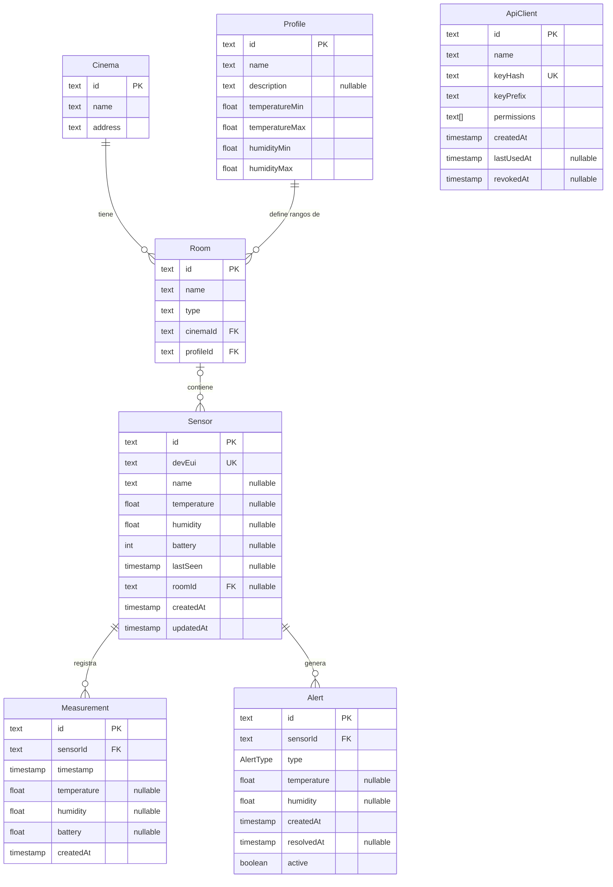

# Base de datos

## Índice

1. [Resumen](#1-resumen)
2. [Diagrama entidad-relación](#2-diagrama-entidad-relación)
3. [Tablas](#3-tablas)
4. [Enums](#4-enums)
5. [Relaciones y reglas de borrado](#5-relaciones-y-reglas-de-borrado)
6. [Índices y restricciones](#6-índices-y-restricciones)
7. [Carga de datos iniciales](#7-carga-de-datos-iniciales)
8. [Consultas SQL útiles](#8-consultas-sql-útiles)
9. [Migraciones](#9-migraciones)
10. [Crear, replicar o migrar la base](#10-crear-replicar-o-migrar-la-base)
11. [Volumen y mantenimiento](#11-volumen-y-mantenimiento)

---

## 1. Resumen

| Tema | Detalle |
|---|---|
| Motor | PostgreSQL (la instancia actual está en Supabase) |
| ORM | Prisma 7 — el modelo está en [`prisma/schema.prisma`](../prisma/schema.prisma), que es la **fuente de verdad** |
| Migraciones | SQL versionado en [`prisma/migrations/`](../prisma/migrations/) (8 migraciones) |
| Esquema | `public` |
| Tablas de negocio | `Cinema`, `Room`, `Profile`, `Sensor`, `Measurement`, `Alert` |
| Tabla de acceso | `ApiClient` (claves de API de terceros, guardadas como hash) |
| Tabla técnica | `_prisma_migrations` (registro de migraciones aplicadas, la administra Prisma) |
| Claves primarias | `TEXT`, con CUID generado por Prisma |
| Fechas | `TIMESTAMP(3)` sin zona horaria, **guardadas en UTC** |

### Convenciones importantes para SQL directo

- Los nombres de tablas y columnas tienen mayúsculas (`"Sensor"`, `"lastSeen"`), así que en SQL **siempre van entre comillas dobles**. `SELECT * FROM sensor` falla; `SELECT * FROM "Sensor"` funciona.
- Los `id` **no tienen valor por defecto en la base**: el CUID lo genera Prisma. Al insertar por SQL hay que enviar el `id` (se puede usar `gen_random_uuid()::text`).
- `Sensor."updatedAt"` es `NOT NULL` y **no tiene default en la base** (lo completa Prisma). Al insertar por SQL hay que enviarlo.
- Las fechas son UTC. Si la sesión SQL no está en UTC, comparar con `now() AT TIME ZONE 'UTC'` en lugar de `now()`.

---

## 2. Diagrama entidad-relación



`ApiClient` no tiene relaciones: es la lista de claves de API de terceros (ver [`ApiClient`](#apiclient)).

**Lectura del modelo**

- Un **cine** tiene muchas **salas**.
- Cada **sala** tiene exactamente un **perfil** (rangos de temperatura/humedad). Un perfil se puede reutilizar en muchas salas.
- Una **sala** tiene cero o más **sensores**. Un sensor puede no tener sala (recién detectado).
- Cada **sensor** guarda su **estado actual** en sus propias columnas (`temperature`, `humidity`, `battery`, `lastSeen`) y su **histórico** en `Measurement`.
- Cada **sensor** acumula **alertas**; una alerta está activa mientras la condición persiste y luego queda como histórico.

---

## 3. Tablas

### `Cinema`

Cine o complejo.

| Columna | Tipo | Nulo | Default | Descripción |
|---|---|---|---|---|
| `id` | `TEXT` | No | — (Prisma: `cuid()`) | PK |
| `name` | `TEXT` | No | — | Nombre del cine |
| `address` | `TEXT` | No | — | Dirección |

### `Room`

Sala o ambiente dentro de un cine.

| Columna | Tipo | Nulo | Default | Descripción |
|---|---|---|---|---|
| `id` | `TEXT` | No | — (Prisma: `cuid()`) | PK |
| `name` | `TEXT` | No | — | Nombre de la sala (ej. "Sala 3") |
| `type` | `TEXT` | No | — | Tipo de ambiente. Texto libre; el frontend usa `projection`, `hall`, `lobby`, `storage`, `other` |
| `cinemaId` | `TEXT` | No | — | FK → `Cinema.id` |
| `profileId` | `TEXT` | No | — | FK → `Profile.id` |

### `Profile`

Conjunto de rangos aceptables. Se asigna a salas.

| Columna | Tipo | Nulo | Default | Descripción |
|---|---|---|---|---|
| `id` | `TEXT` | No | — (Prisma: `cuid()`) | PK |
| `name` | `TEXT` | No | — | Nombre del perfil |
| `description` | `TEXT` | Sí | — | Descripción opcional |
| `temperatureMin` | `DOUBLE PRECISION` | No | — | Temperatura mínima aceptable (°C) |
| `temperatureMax` | `DOUBLE PRECISION` | No | — | Temperatura máxima aceptable (°C) |
| `humidityMin` | `DOUBLE PRECISION` | No | — | Humedad mínima aceptable (%) |
| `humidityMax` | `DOUBLE PRECISION` | No | — | Humedad máxima aceptable (%) |

La regla `min < max` se valida en la API, **no** en la base (no hay `CHECK`).

### `Sensor`

Dispositivo LoRaWAN. Además de su identidad, guarda **la última lectura recibida** para poder mostrar el estado actual sin consultar el histórico.

| Columna | Tipo | Nulo | Default | Descripción |
|---|---|---|---|---|
| `id` | `TEXT` | No | — (Prisma: `cuid()`) | PK |
| `devEui` | `TEXT` | No | — | DevEUI LoRaWAN, en minúsculas. **Único** |
| `name` | `TEXT` | Sí | — | Nombre visible. Al crearse toma el `deviceName` del gateway |
| `temperature` | `DOUBLE PRECISION` | Sí | — | Última temperatura (°C) |
| `humidity` | `DOUBLE PRECISION` | Sí | — | Última humedad (%) |
| `battery` | `INTEGER` | Sí | — | Último nivel de batería (%) |
| `lastSeen` | `TIMESTAMP(3)` | Sí | — | Fecha de la última lectura (hora del gateway) |
| `roomId` | `TEXT` | Sí | — | FK → `Room.id`. `NULL` = sensor sin asignar |
| `createdAt` | `TIMESTAMP(3)` | No | `CURRENT_TIMESTAMP` | Alta del sensor |
| `updatedAt` | `TIMESTAMP(3)` | No | — (Prisma: `@updatedAt`) | Última modificación de la fila |

El estado `online`/`offline` **no se guarda**: la API lo calcula a partir de `lastSeen` (online si tiene menos de 30 minutos).

### `Measurement`

Histórico de lecturas. Una fila por cada mensaje recibido en `POST /api/telemetry`. Es la tabla que más crece.

| Columna | Tipo | Nulo | Default | Descripción |
|---|---|---|---|---|
| `id` | `TEXT` | No | — (Prisma: `cuid()`) | PK |
| `sensorId` | `TEXT` | No | — | FK → `Sensor.id` |
| `timestamp` | `TIMESTAMP(3)` | No | — | Hora de la lectura (informada por el gateway, o del servidor si no vino) |
| `temperature` | `DOUBLE PRECISION` | Sí | — | °C |
| `humidity` | `DOUBLE PRECISION` | Sí | — | % |
| `battery` | `DOUBLE PRECISION` | Sí | — | % (en `Sensor` es `INTEGER`) |
| `createdAt` | `TIMESTAMP(3)` | No | `CURRENT_TIMESTAMP` | Hora en que el backend guardó la fila |

`timestamp` vs `createdAt`: la diferencia entre ambos es la demora entre el gateway y el backend. Todas las consultas de la API filtran y ordenan por `timestamp`.

### `Alert`

Alertas de valores fuera de rango.

| Columna | Tipo | Nulo | Default | Descripción |
|---|---|---|---|---|
| `id` | `TEXT` | No | — (Prisma: `cuid()`) | PK |
| `sensorId` | `TEXT` | No | — | FK → `Sensor.id` |
| `type` | `"AlertType"` | No | — | Motivo (ver [enum](#alerttype)) |
| `temperature` | `DOUBLE PRECISION` | Sí | — | Temperatura del sensor al crearse la alerta. `NULL` = el sensor no informó ese dato |
| `humidity` | `DOUBLE PRECISION` | Sí | — | Humedad del sensor al crearse la alerta. `NULL` = el sensor no informó ese dato |
| `createdAt` | `TIMESTAMP(3)` | No | `CURRENT_TIMESTAMP` | Inicio de la alerta |
| `resolvedAt` | `TIMESTAMP(3)` | Sí | — | Fin de la alerta. `NULL` mientras está activa |
| `active` | `BOOLEAN` | No | `true` | `true` = alerta en curso |

Invariante esperado (lo mantiene la aplicación, no la base): `active = true ⇔ resolvedAt IS NULL`.

> Las alertas creadas antes de la migración 8 tienen `0` (y no `NULL`) cuando faltaba el dato. Para distinguirlas se puede comparar `createdAt` con la fecha en que se aplicó la migración.

La aplicación mantiene **como máximo una alerta activa por sensor y tipo**. Si por dos lecturas simultáneas quedara un duplicado, la evaluación siguiente lo resuelve sola. La base todavía no lo impide (no hay índice único parcial).

### `ApiClient`

Clientes externos autorizados a **escribir** en la API (la lectura es pública). Se administran solo con el script `npm run clients` (no hay endpoints para esto).

| Columna | Tipo | Nulo | Default | Descripción |
|---|---|---|---|---|
| `id` | `TEXT` | No | — (Prisma: `cuid()`) | PK |
| `name` | `TEXT` | No | — | Nombre descriptivo del cliente (ej. "App de Juan") |
| `keyHash` | `TEXT` | No | — | SHA-256 (hex) de la clave. **La clave en sí nunca se guarda** |
| `keyPrefix` | `TEXT` | No | — | Primeros 10 caracteres de la clave, para reconocerla en listados |
| `permissions` | `TEXT[]` | No | — | Permisos de escritura: `sensors:write`, `profiles:write`. Vacío = solo lectura |
| `createdAt` | `TIMESTAMP(3)` | No | `CURRENT_TIMESTAMP` | Alta |
| `lastUsedAt` | `TIMESTAMP(3)` | Sí | — | Último uso (se actualiza como mucho una vez por hora) |
| `revokedAt` | `TIMESTAMP(3)` | Sí | — | Fecha de revocación. Con valor, la clave deja de funcionar |

La tabla tiene **RLS activado sin políticas**: en Supabase no es accesible por la Data API; el backend (dueño de la tabla) la usa normalmente. La clave de administrador **no** está en esta tabla: se define en la variable de entorno `ADMIN_API_KEY`.

### `_prisma_migrations`

Tabla interna de Prisma con las migraciones aplicadas. No modificar a mano.

---

## 4. Enums

### `AlertType`

| Valor | Significado |
|---|---|
| `temperature_high` | Temperatura mayor que `Profile.temperatureMax` |
| `temperature_low` | Temperatura menor que `Profile.temperatureMin` |
| `humidity_high` | Humedad mayor que `Profile.humidityMax` |
| `humidity_low` | Humedad menor que `Profile.humidityMin` |

---

## 5. Relaciones y reglas de borrado

| FK | Columna → Referencia | Obligatoria | `ON DELETE` | Efecto al borrar el padre |
|---|---|---|---|---|
| `Room_cinemaId_fkey` | `Room.cinemaId` → `Cinema.id` | Sí | `CASCADE` | Borrar un cine **borra sus salas** (y sus sensores quedan sin sala) |
| `Room_profileId_fkey` | `Room.profileId` → `Profile.id` | Sí | `RESTRICT` | **No se puede** borrar un perfil asignado a alguna sala |
| `Sensor_roomId_fkey` | `Sensor.roomId` → `Room.id` | No | `SET NULL` | Borrar una sala deja sus sensores **sin sala**; se conservan el sensor y su histórico |
| `Measurement_sensorId_fkey` | `Measurement.sensorId` → `Sensor.id` | Sí | `CASCADE` | Borrar un sensor **borra todo su histórico** |
| `Alert_sensorId_fkey` | `Alert.sensorId` → `Sensor.id` | Sí | `CASCADE` | Borrar un sensor **borra sus alertas** |

Todas las FK tienen `ON UPDATE CASCADE`.

Consecuencia práctica: borrar un cine **no** borra sensores ni mediciones; los sensores quedan "huérfanos" (sin sala) y pueden reasignarse.

---

## 6. Índices y restricciones

| Nombre | Tabla | Columnas | Tipo | Uso |
|---|---|---|---|---|
| `Cinema_pkey` | `Cinema` | `id` | PK | |
| `Room_pkey` | `Room` | `id` | PK | |
| `Profile_pkey` | `Profile` | `id` | PK | |
| `Sensor_pkey` | `Sensor` | `id` | PK | |
| `Sensor_devEui_key` | `Sensor` | `devEui` | `UNIQUE` | Búsqueda y alta automática por DevEUI |
| `Measurement_pkey` | `Measurement` | `id` | PK | |
| `Measurement_sensorId_timestamp_idx` | `Measurement` | `sensorId`, `timestamp` | Índice | Histórico de un sensor por rango de fechas |
| `Alert_pkey` | `Alert` | `id` | PK | |
| `ApiClient_pkey` | `ApiClient` | `id` | PK | |
| `ApiClient_keyHash_key` | `ApiClient` | `keyHash` | `UNIQUE` | Validar una clave con una sola búsqueda |

PostgreSQL **no** crea índices automáticamente en las columnas FK. Actualmente no hay índices en `Room.cinemaId`, `Room.profileId`, `Sensor.roomId`, `Alert.sensorId` ni `Alert.active`. Con pocos datos no hay impacto; con muchas alertas o mediciones conviene agregarlos (ver [sección 11](#11-volumen-y-mantenimiento)).

No hay restricciones `CHECK` (por ejemplo `min < max`, rangos de batería) ni unicidad en nombres de cines, salas o perfiles.

---

## 7. Carga de datos iniciales

La API permite crear perfiles, pero **no cines ni salas**. Estos scripts sirven para cargar los datos base en una base recién creada. Ejecutarlos en orden.

```sql
-- 1) Perfiles (también se pueden crear con POST /api/profiles)
INSERT INTO "Profile" ("id", "name", "description", "temperatureMin", "temperatureMax", "humidityMin", "humidityMax")
VALUES
  (gen_random_uuid()::text, 'Sala de proyección', 'Cabinas y salas de proyección', 18, 26, 30, 60),
  (gen_random_uuid()::text, 'Depósito',           'Depósitos de insumos',          10, 30, 20, 70);

-- 2) Cines
INSERT INTO "Cinema" ("id", "name", "address")
VALUES
  (gen_random_uuid()::text, 'Cine Centro', 'Av. Siempre Viva 742');

-- 3) Salas (se vinculan por nombre al cine y al perfil; los nombres usados deben ser únicos)
INSERT INTO "Room" ("id", "name", "type", "cinemaId", "profileId")
SELECT gen_random_uuid()::text, r.name, r.type, c."id", p."id"
FROM (VALUES
        ('Sala 1',   'projection', 'Cine Centro', 'Sala de proyección'),
        ('Sala 2',   'projection', 'Cine Centro', 'Sala de proyección'),
        ('Depósito', 'storage',    'Cine Centro', 'Depósito')
     ) AS r(name, type, cinema_name, profile_name)
JOIN "Cinema"  c ON c."name" = r.cinema_name
JOIN "Profile" p ON p."name" = r.profile_name;

-- 4) Sensores: NO hace falta crearlos. Se crean solos con la primera lectura del gateway.
--    Luego se asignan con PATCH /api/sensors/:devEui  { "name": "...", "roomId": "..." }
--    o por SQL:
UPDATE "Sensor"
SET "roomId" = (SELECT "id" FROM "Room" WHERE "name" = 'Sala 1'),
    "name" = 'Sala 1 - Cabina',
    "updatedAt" = now() AT TIME ZONE 'UTC'
WHERE "devEui" = 'a1b2c3d4e5f60718';
```

Si se prefiere precargar un sensor antes de que transmita:

```sql
INSERT INTO "Sensor" ("id", "devEui", "name", "roomId", "updatedAt")
VALUES (gen_random_uuid()::text, lower('A1B2C3D4E5F60718'), 'Sala 1 - Cabina',
        (SELECT "id" FROM "Room" WHERE "name" = 'Sala 1'), now() AT TIME ZONE 'UTC');
```

> El `devEui` **debe** guardarse en minúsculas: la API lo busca así.

Reasignar las salas de un perfil a otro (necesario antes de borrar un perfil en uso):

```sql
UPDATE "Room"
SET "profileId" = (SELECT "id" FROM "Profile" WHERE "name" = 'Depósito')
WHERE "profileId" = (SELECT "id" FROM "Profile" WHERE "name" = 'Perfil a borrar');
```

---

## 8. Consultas SQL útiles

**Alertas activas con su contexto**

```sql
SELECT a."type", a."createdAt", a."temperature", a."humidity",
       s."name" AS sensor, s."devEui", r."name" AS sala, c."name" AS cine
FROM "Alert" a
JOIN "Sensor" s      ON s."id" = a."sensorId"
LEFT JOIN "Room" r   ON r."id" = s."roomId"
LEFT JOIN "Cinema" c ON c."id" = r."cinemaId"
WHERE a."active" = true
ORDER BY a."createdAt" DESC;
```

**Sensores offline (sin datos en los últimos 30 minutos)**

```sql
SELECT "devEui", "name", "lastSeen"
FROM "Sensor"
WHERE "lastSeen" IS NULL
   OR "lastSeen" < (now() AT TIME ZONE 'UTC') - interval '30 minutes'
ORDER BY "lastSeen" NULLS FIRST;
```

**Sensores sin sala asignada**

```sql
SELECT "devEui", "name", "createdAt" FROM "Sensor" WHERE "roomId" IS NULL;
```

**Promedio, mínimo y máximo diario por sensor (últimos 30 días)**

```sql
SELECT s."name",
       date_trunc('day', m."timestamp") AS dia,
       round(avg(m."temperature")::numeric, 2) AS temp_prom,
       min(m."temperature") AS temp_min,
       max(m."temperature") AS temp_max,
       round(avg(m."humidity")::numeric, 2) AS hum_prom
FROM "Measurement" m
JOIN "Sensor" s ON s."id" = m."sensorId"
WHERE m."timestamp" >= (now() AT TIME ZONE 'UTC') - interval '30 days'
GROUP BY s."name", dia
ORDER BY s."name", dia;
```

**Inventario completo: cine → sala → perfil → sensores**

```sql
SELECT c."name" AS cine, r."name" AS sala, r."type", p."name" AS perfil,
       count(s."id") AS sensores
FROM "Cinema" c
JOIN "Room" r      ON r."cinemaId" = c."id"
JOIN "Profile" p   ON p."id" = r."profileId"
LEFT JOIN "Sensor" s ON s."roomId" = r."id"
GROUP BY c."name", r."name", r."type", p."name"
ORDER BY c."name", r."name";
```

**Tamaño de las tablas**

```sql
SELECT relname AS tabla,
       n_live_tup AS filas_aprox,
       pg_size_pretty(pg_total_relation_size(relid)) AS tamaño
FROM pg_stat_user_tables
ORDER BY pg_total_relation_size(relid) DESC;
```

---

## 9. Migraciones

| # | Migración | Cambios |
|---|---|---|
| 1 | `20260810231243_initial` | Crea `Sensor` (sin batería ni sala) y `Measurement`; índice único `devEui`; índice `(sensorId, timestamp)` |
| 2 | `20260812030327_add_battery` | Agrega `Sensor.battery INTEGER` |
| 3 | `20260812160710_add_profiles` | Crea `Profile` (con `createdAt`/`updatedAt`) |
| 4 | `20260812162251_mod_profiles` | Quita `createdAt`/`updatedAt` de `Profile` |
| 5 | `20260812165842_add_cinemas_rooms` | Crea `Cinema` y `Room`; agrega `Sensor.roomId`; FK con reglas de borrado |
| 6 | `20260812211853_add_alerts` | Crea el enum `AlertType` y la tabla `Alert` |
| 7 | `20260813170456_add_battery_to_measurement` | Agrega `Measurement.battery DOUBLE PRECISION` |
| 8 | `20261110120000_api_clients_nullable_alert_values` | `Alert.temperature` y `Alert.humidity` pasan a aceptar `NULL`; crea `ApiClient` con RLS activado. **Compatible con la versión anterior del backend**: se puede aplicar antes de desplegar el código nuevo |

**Cómo se usan**

- La CLI de Prisma se conecta con `DIRECT_URL` (configurado en `prisma.config.ts`).
- Base nueva o producción: `npx prisma migrate deploy` (aplica las migraciones pendientes; a diferencia de `migrate dev`, nunca resetea la base).
- Para cambiar el modelo: editar `prisma/schema.prisma` → `npx prisma migrate dev --name descripcion_del_cambio` (genera el SQL en una carpeta nueva y lo aplica en la base de desarrollo) → `npx prisma generate`.
- **No** modificar migraciones ya aplicadas: Prisma guarda un checksum en `_prisma_migrations` y detecta los cambios.
- **No** hacer cambios de estructura a mano en la base (por ejemplo desde el panel de Supabase): la siguiente migración detectaría diferencias (*drift*).

---

## 10. Crear, replicar o migrar la base

### Base nueva y vacía

```bash
# con DATABASE_URL y DIRECT_URL apuntando a la base nueva
npx prisma migrate deploy
npx prisma generate
```

Luego cargar los datos iniciales ([sección 7](#7-carga-de-datos-iniciales)).

### Copiar los datos de una base existente a otra

Requiere las herramientas cliente de PostgreSQL (`pg_dump`, `psql`) en una versión **igual o mayor** a la del servidor de origen.

```bash
# 1. Crear la estructura en la base destino
DIRECT_URL="postgresql://...destino..." npx prisma migrate deploy

# 2. Exportar solo los datos de las tablas de negocio desde el origen
pg_dump "postgresql://...origen..." \
  --data-only --no-owner --no-privileges \
  -t '"Profile"' -t '"Cinema"' -t '"Room"' -t '"Sensor"' -t '"Measurement"' -t '"Alert"' \
  -f datos.sql

# 3. Importar en el destino
psql "postgresql://...destino..." -f datos.sql
```

Para exportar solo la configuración (sin histórico ni alertas), quitar `-t '"Measurement"'` y `-t '"Alert"'`. `ApiClient` no se copia a propósito: las claves son de cada entorno.

### Notas sobre Supabase

- `DATABASE_URL` usa el *transaction pooler* (puerto 6543, `?pgbouncer=true`) y `DIRECT_URL` el *session pooler* (puerto 5432). Las migraciones deben ir por `DIRECT_URL`.
- Las tablas están en el esquema `public`. Si la *Data API* de Supabase está habilitada y las tablas no tienen RLS activado, son accesibles mediante la API REST de Supabase con la clave `anon`. Este backend no usa esa API: se recomienda activar RLS en las seis tablas de negocio (Prisma se conecta como dueño de las tablas y no se ve afectado). `ApiClient` ya se crea con RLS activado o desactivar la Data API. El *Security Advisor* del panel de Supabase lo señala.

---

## 11. Volumen y mantenimiento

**Crecimiento de `Measurement`.** Se guarda una fila por cada mensaje del gateway. Como referencia, un sensor que reporta cada 10 minutos genera 144 filas por día, unas 52.500 por año. No hay política de retención ni agregación: el histórico crece indefinidamente.

**Índices recomendados** si el volumen crece (se agregan en `schema.prisma` y se genera una migración):

```prisma
model Room {
  // ...
  @@index([cinemaId])
  @@index([profileId])
}

model Sensor {
  // ...
  @@index([roomId])
}

model Alert {
  // ...
  @@index([sensorId, active])
  @@index([active, createdAt])
}

model Measurement {
  // ...
  @@index([timestamp])   // para GET /api/measurements sin filtro de sensor
}
```

**Limpieza de histórico** (ejemplo: borrar mediciones de más de 1 año):

```sql
DELETE FROM "Measurement"
WHERE "timestamp" < (now() AT TIME ZONE 'UTC') - interval '1 year';
```
